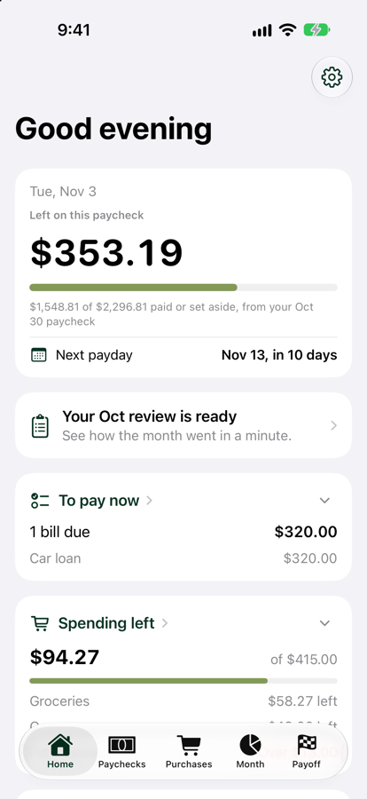
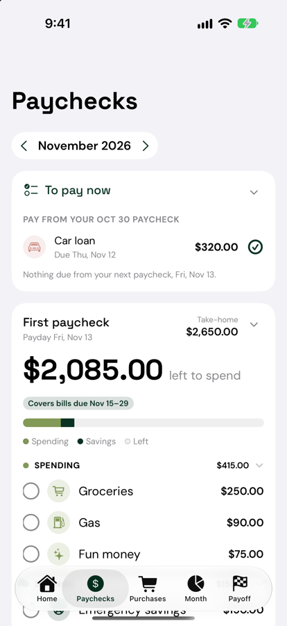
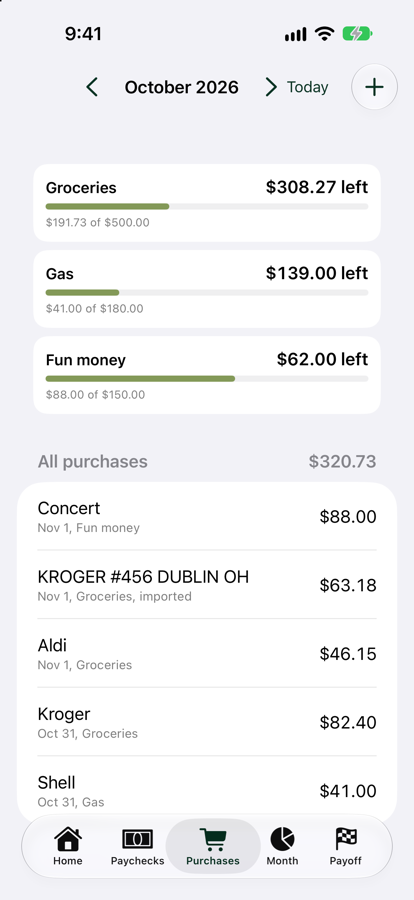
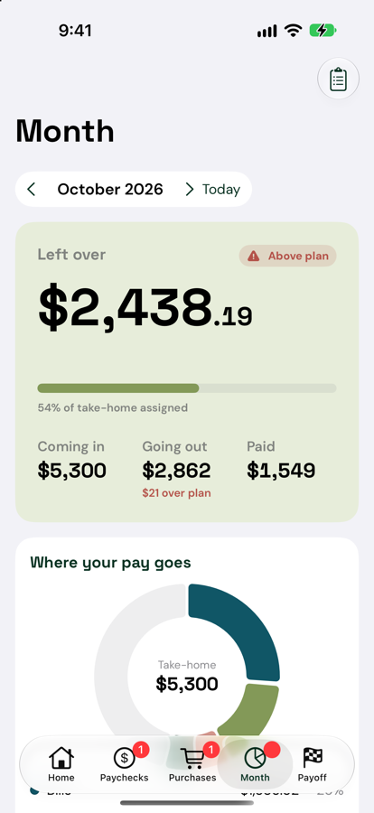
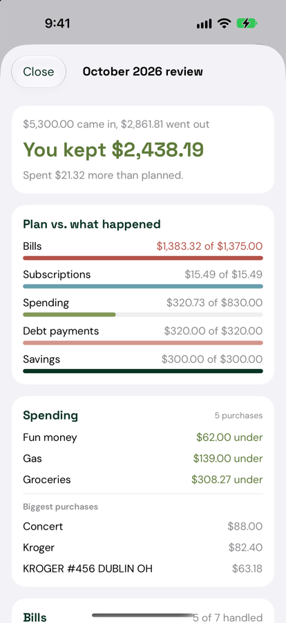
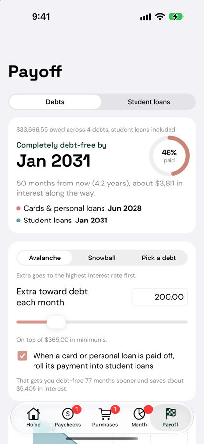
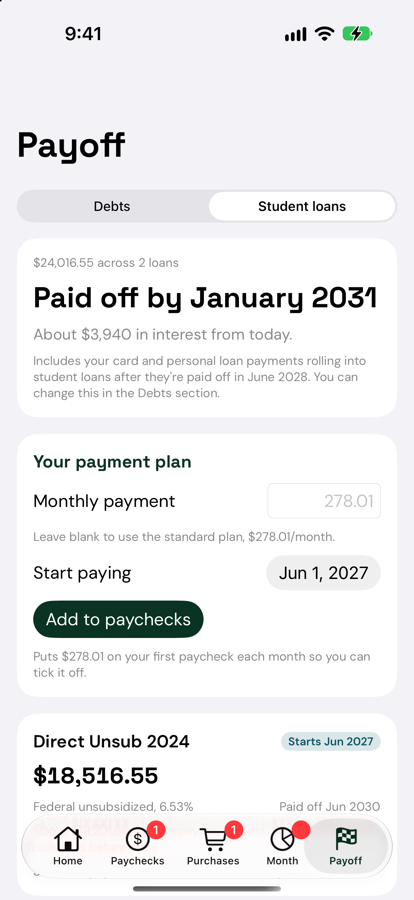
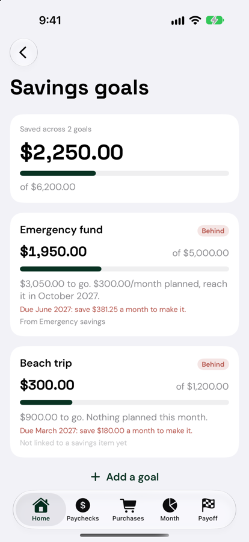
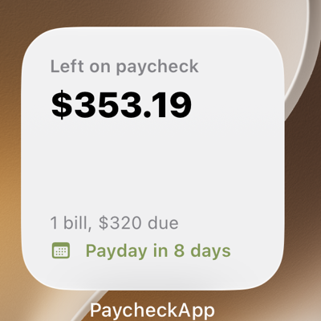

# Paycheck Plan for iPhone and Mac

A native SwiftUI version of the Paycheck Plan web app. It plans your budget one paycheck at a time: which bills each paycheck covers, what's left to spend, and how fast your debt and loans go away. It reads the same backup file as the web app, so your budget moves over in one step.

## Screenshots

Shown with sample data.

<table>
  <tr>
    <td align="center"><br><sub>Home</sub></td>
    <td align="center"><br><sub>Paychecks</sub></td>
    <td align="center"><br><sub>Purchases</sub></td>
  </tr>
  <tr>
    <td align="center"><br><sub>Month</sub></td>
    <td align="center"><br><sub>Monthly review</sub></td>
    <td align="center"><br><sub>Payoff: debts and utilization</sub></td>
  </tr>
  <tr>
    <td align="center"><br><sub>Payoff: student loans</sub></td>
    <td align="center"><br><sub>Savings goals</sub></td>
    <td align="center"><br><sub>Home screen widget</sub></td>
  </tr>
</table>

## What's in the app

### Tabs

- **Home**: what's left on this paycheck, your next payday, bills to pay now, spending left, debt, and savings goals. Each card folds to one line. The gear in the top corner opens **Setup**.
- **Paychecks**: every paycheck in the month with its bills grouped by type. Each item can be not paid, set aside, or paid. Also autopay, moving a bill to another paycheck, skipping a month, one-time items, and pay-ahead. Paychecks and type groups fold.
- **Purchases**: spending categories stacked with what's left in each, logging purchases, moving them between categories, swipe to delete, and **Import from bank** in the **+** menu.
- **Month**: what came in and went out, where your pay goes, and over-budget items. The clipboard button opens the **monthly review**.
- **Payoff**: two sections.
  - **Debts**: your debt-free date, Avalanche, Snowball, or Pick a debt, the extra payment line on your paychecks, and **credit utilization**.
  - **Student loans**: what each loan grows to before repayment, standard payments, your payment plan, and payoff dates.

### Features

- **Bank import**: reads the CSV file you download from your bank and suggests where each transaction goes. See [Import from your bank](#import-from-your-bank).
- **Savings goals**: a target, what's saved, an optional target date, and whether you're on track. Link a savings item on your paychecks to a goal, and marking it paid moves the goal forward.
- **Credit utilization**: how much of your credit limits you're using overall and per card, and what to pay to get under 30% and 10%. Add a **Credit limit** to a card in its debt settings.
- **Monthly review**: plan vs. actual, each category over or under, bills not marked paid, debt paid, savings, and a comparison with the month before. Early each month, Home reminds you that last month's review is ready.
- **Windfall planner**: for a tax refund or bonus. On Home, tap **Got extra money? Plan it**. It suggests a split, shows how much sooner you'll be debt-free and how much interest you'll save, and can apply it to your balances.
- **Widgets**: small and medium home screen widgets, plus lock screen widgets. They show what's left on your paycheck, bills due, days to payday, spending left, and your top goal.
- **Reminders**: a notification the day before each unpaid bill is due, and one on payday. Turn on in **Setup → Reminders**.
- **Face ID lock**: asks for Face ID or your passcode when you come back to the app, and hides balances in the app switcher. Turn on in **Setup → Privacy**.
- **Light and dark mode**, with app icons for both.

## Run it

You need Xcode 27 or later (free in the Mac App Store).

1. Get the code:
   ```bash
   git clone https://github.com/aubribowman/budget-tracker.git
   ```
2. Open `PaycheckApp.xcodeproj` in Xcode.
3. Pick an iPhone simulator from the device menu at the top of the window and press **⌘R**.

The simulator starts with an empty budget. Import a backup (see below) to see your own numbers.

## Put it on your iPhone

1. Plug your iPhone into the Mac. On the phone, go to **Settings → Privacy & Security → Developer Mode** and turn it on. The phone restarts.
2. In Xcode, click the blue **PaycheckApp** project at the top of the sidebar. For both the **PaycheckApp** and **PaycheckWidget** targets, open **Signing & Capabilities**, check **Automatically manage signing**, and pick your **Team**.
3. Choose your iPhone from the device menu and press **⌘R**. The first time, on the phone go to **Settings → General → VPN & Device Management** and trust your developer certificate.

The app's ID is `com.aubribowman.PaycheckApp`, the widget's is `com.aubribowman.PaycheckApp.PaycheckWidget`, and they share data through the App Group `group.com.aubribowman.PaycheckApp`. If you sign with a different Apple account and Xcode says an ID is taken, change all three to your own (for example, swap `aubribowman` for your name). Make the same change in `PaycheckApp.entitlements`, `PaycheckWidget.entitlements`, `PaycheckApp/Support/WidgetSync.swift` and `PaycheckWidget/PaycheckWidget.swift`.

With a free Apple ID, the app stops opening after 7 days. Run it from Xcode again to reset that. A paid Apple Developer account ($99/year) removes the limit and adds TestFlight.

## Run it on your Mac

Needs a Mac with an Apple chip.

1. In Xcode, pick **My Mac** from the device menu at the top of the window.
2. Press **⌘R**. The first time, Xcode sets up signing for the Mac the same way it does for your iPhone.

The Mac app has everything except widgets, which are iPhone only for now. Face ID becomes Touch ID on Macs that have it. To keep the app, drag it from Xcode's **Products** folder (Product → Show Build Folder in Finder) into your Applications folder.

## Move your data over

1. In the web app, go to **Setup → Saving and backups → Download a backup**. Save or AirDrop the file to your iPhone's **Files** app.
2. In the iPhone app, tap the gear on Home, then **Import a backup**, and choose the file.

To go the other way, use **Create a backup → Share backup file** in the app, then **Restore from a backup** in the web app.

## Keep your iPhone and Mac in sync

1. In the **Files** app on your iPhone (or Finder on your Mac), make a folder in **iCloud Drive**, for example `Paycheck Plan`.
2. In the app on each device, open **Setup → Sync between devices → Choose a sync folder** and pick that folder.
3. On the second device, the app finds the budget already there and asks which copy to keep. Choose **Use the folder's budget** to bring your existing plan over.

After that, each change is saved to a file named `Paycheck Plan.json` in that folder, and iCloud copies it to your other devices. The app checks for changes when it opens and every 30 seconds while it's open. **Sync now** checks right away.

- If you change both devices before they've had a chance to sync, the most recently saved copy wins and the other change is lost. Give iCloud a moment between devices.
- Sync works with a free Apple ID, because the app only uses a folder you pick. It doesn't need Apple's built-in iCloud sync.
- The sync file uses the same format as a backup, so you can also import it in the web app.

## Import from your bank

1. On your bank's website, download your transactions as a **CSV** file and save it to the Files app.
2. In the app, on the **Purchases** tab, tap **+ → Import from bank**. You can also go to Setup → **Import from bank (CSV)**.
3. Check where each transaction goes:
   - a **spending category**, which logs it as a purchase
   - a **bill**, which marks that bill paid on the right paycheck at the amount you actually paid
   - **Skip**
4. Tap **Import**.

- **Suggestions:** the app suggests destinations from your saved rules, bill names, matching amounts, and, for Crew, pocket names.
- **Rules:** when you change a suggestion, **Always do this for…** saves a rule for that store.
- **No duplicates:** importing the same file again skips anything already imported.
- **Supported banks:** tested with Chase, Bank of America, Capital One, Wells Fargo, and Crew. Most other banks work too. If your spending shows up under **Money in**, turn on **Spending shows as positive**.
- **Crew files:** moves between pockets and pending charges are skipped automatically.

Rules and import history are kept separately from the web app's, so don't import the same transactions in both.

## Project layout

```
PaycheckApp/              The app
  App/                    App entry, tabs, Face ID lock, Store (saving and every change)
  Engine/                 Budget math: paychecks, lines, totals, debt payoff, goals, student loans
  Model/                  The data, in the same format as the web app's backup file
  Support/                Dates and money, colors, reminders, bank CSV reader, widget data,
                          and Platform.swift (iPhone-only touches with their Mac versions)
  Views/                  One file per screen
  Assets.xcassets         App icon (light and dark) and colors
PaycheckWidget/           Home and lock screen widgets
docs/screenshots/         Screenshots used in this README
PaycheckWidget-Info.plist Widget settings
*.entitlements            App Group that lets the app and widget share data, and Mac file access for sync
```

## How the code works

Data moves one way:

1. **`BudgetState`** ([Models.swift](PaycheckApp/Model/Models.swift)) is the whole budget, exactly as it's saved, synced and backed up.
2. **`Store`** ([Store.swift](PaycheckApp/App/Store.swift)) holds it and is the only thing that changes it. Every change goes through `store.update { ... }`, which saves and syncs.
3. **`Engine`** ([Engine.swift](PaycheckApp/Engine/Engine.swift)) works out the numbers from a snapshot: paydays, what's on each paycheck, totals, balances and payoff dates. It never changes the budget. The Store makes a new one after every change.
4. **Views** read `store.state` for data and `store.engine` for numbers, and call Store functions to make changes.

A paycheck is built like this: find the paydays in the month (`checksIn`), give each one a date range (`windowFor`), put each recurring item on the paycheck whose range holds its due date (`naturalRec`), add moved and one-time items (`lines`), then add it all up (`totals`). Changes for a single paycheck, like marking a bill paid, are stored as an `Override` on that paycheck, not on the recurring item.

### Things to keep in mind

- **Stay compatible with the web app.** The backup file is shared with the web app, so keep field names the same, decode new fields with a default, and don't remove fields the web app uses. The payoff math (`simulateAll` in [Engine+Loans.swift](PaycheckApp/Engine/Engine+Loans.swift)) is a port of the web app's, so both should show the same dates.
- **Dates are text.** Months are `"yyyy-MM"` and days are `"yyyy-MM-dd"`, compared as plain strings. Use the helpers in [DateUtil.swift](PaycheckApp/Support/DateUtil.swift).
- **Round money with `r2`** before saving it.
- **iPhone vs. Mac.** Screens are shared. Put iPhone-only modifiers behind a helper in [Platform.swift](PaycheckApp/Support/Platform.swift) with a Mac version, instead of adding `#if os(...)` in each screen.
- **Widget data.** If you change what the widget shows, update both `WidgetSync.Summary` in the app and `WidgetSummary` in the widget.

## Not yet

- **Widgets on Mac.** Widgets are built for iPhone only.
- **Automatic background sync.** Sync works through a folder you pick (see above). Apple's built-in iCloud sync, which needs no setup, requires a paid developer account.

## If the build fails

1. Try **Product → Clean Build Folder** (⇧⌘K) and build again.
2. If it still fails, open the **Issue navigator** (the triangle icon in Xcode's left sidebar), copy the red error messages with their file names, and paste them to Claude.
